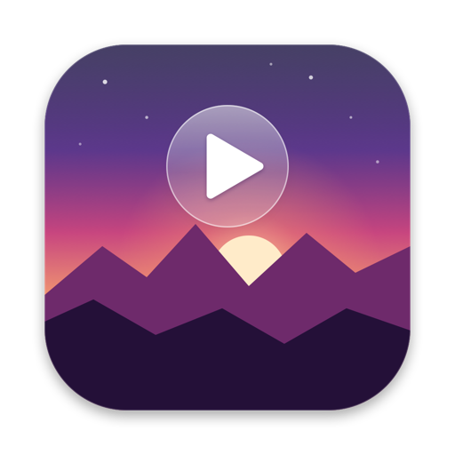
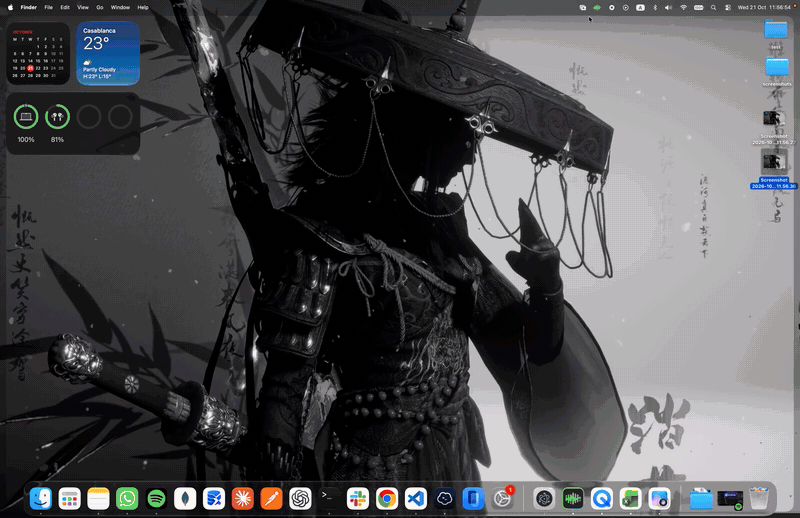
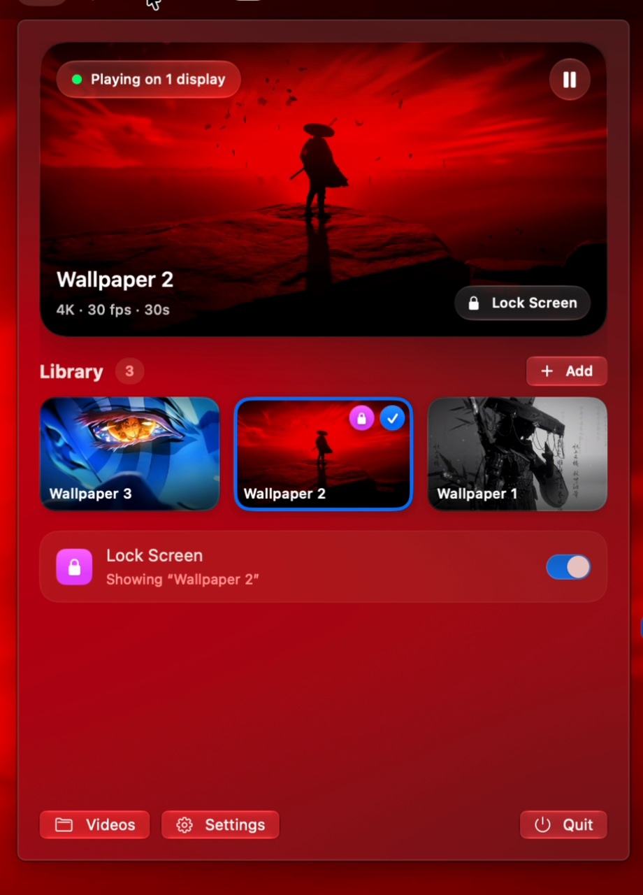
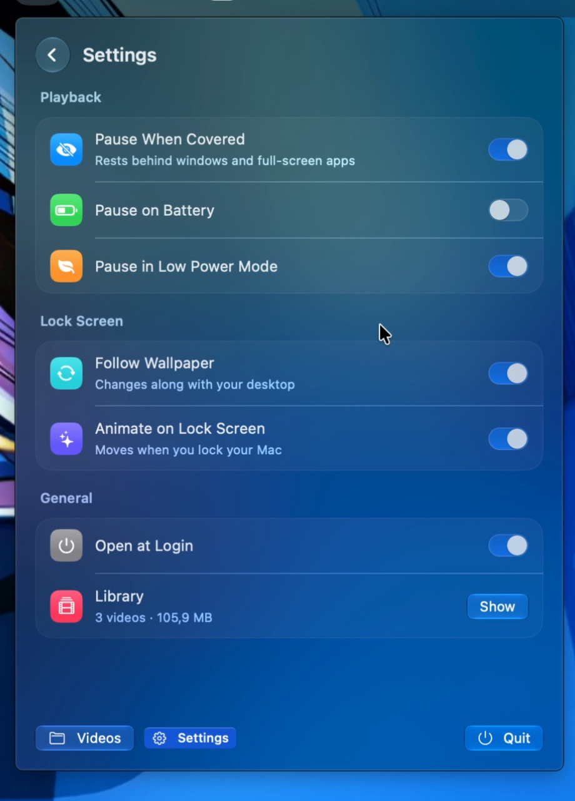
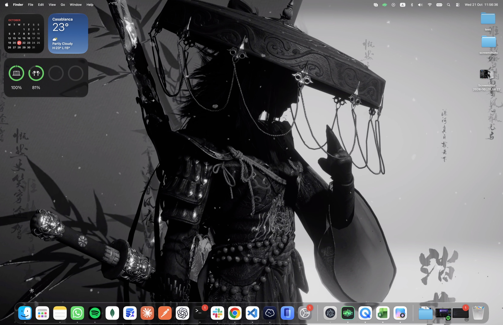

<div align="center">



# LiveWall

**Live video wallpapers for macOS — on every display, every Space, and the lock screen — at almost no cost to your battery.**


<br>

<a href="demo/demo.mp4"></a>

<sub>Switching wallpapers from the menu bar. <a href="demo/demo.mp4">Watch the full-quality video</a>.</sub>

</div>

---

## Screenshots

<table>
  <tr>
    <td align="center" width="50%">
      <br>
      <sub><b>Library</b> — live preview, one click to switch, lock screen in sync</sub>
    </td>
    <td align="center" width="50%">
      <br>
      <sub><b>Settings</b> — pause rules, lock screen options, Open at Login</sub>
    </td>
  </tr>
</table>

<p align="center">
  
  <br><sub>A live wallpaper behind desktop widgets and icons, which stay fully usable.</sub>
</p>

## Features

- **Any video** — MOV, MP4, M4V, and (with `ffmpeg` installed) WebM, MKV and GIF. Drop files on the panel or use Finder › Open With › LiveWall.
- **Smooth** — gapless looping, cross-fades between wallpapers, never a black flash after sleep.
- **Light** — hardware decoding only, one decoder per video shared across displays, and automatic pausing whenever the wallpaper can't be seen.
- **Every display & Space** — pick one video for all displays or a different one per display; works with Mission Control, Stage Manager and full-screen apps, and desktop icons stay clickable.
- **Lock screen & screen saver** — your video plays when you lock your Mac, and can follow your desktop wallpaper automatically. One switch to turn it off and put your old lock screen back.
- **Liquid Glass panel** — a menu bar panel with a live preview of your wallpaper, built with macOS 26's glass design (with a material fallback on macOS 14–15).
- **Private** — no accounts, no analytics, no network access. Everything stays on your Mac.

## Requirements

- macOS 14 Sonoma or later (Liquid Glass styling on macOS 26 and later)
- Apple silicon or Intel Mac with hardware HEVC decoding (2017 or newer)
- To build: Swift 6 — the Xcode Command Line Tools are enough (`xcode-select --install`)

## Install

### Build from source

```bash
git clone https://github.com/charonova/LiveWall.git
cd LiveWall
./scripts/install.sh   # builds, copies to ~/Applications and launches
```

`./scripts/build.sh` alone builds `build/LiveWall.app` without installing it.

### Downloaded builds

Release builds are ad-hoc signed, not notarized. The first time, right-click LiveWall in Finder and choose **Open**, or run:

```bash
xattr -dr com.apple.quarantine /Applications/LiveWall.app
```

## Usage

1. Click the LiveWall icon in the menu bar.
2. **Add Video** (or drag videos onto the panel). Each video is optimized once on import.
3. Click a video to make it your wallpaper. With several displays, choose a display first.
4. Turn on **Lock Screen** to see it when your Mac is locked. Press <kbd>⌃</kbd><kbd>⌘</kbd><kbd>Q</kbd> to try it.

Right-click a video to rename it, put it on the lock screen, show it in Finder or remove it. The **Settings** page has the pause rules, lock screen options and Open at Login.

### Automation

`livewall://` links work from Shortcuts, scripts or Terminal (`open "livewall://pause"`):

| Link | Action |
|---|---|
| `livewall://pause` · `play` · `toggle` | Control playback |
| `livewall://lockscreen/<video-id>` | Put a library video on the lock screen |
| `livewall://lockscreen/off` | Restore the previous lock screen |

Video IDs are listed in `~/Library/Application Support/LiveWall/library.json`.

## How it works

### Playback

Each display gets a borderless window at the desktop window level: above the system wallpaper, below the desktop icons, joined to every Space, and invisible to the mouse. Behind it, an `AVQueuePlayer` with `AVPlayerLooper` loops the video gaplessly. Displays that show the same video share a single player, and the menu bar preview reuses it too, so a video is decoded exactly once.

Playback pauses when the wallpaper is covered by windows or a full-screen app, the screen is locked or asleep, the screen saver runs, another user is active, the Mac is overheating, Low Power Mode is on, and (optionally) on battery. LiveWall never keeps the display awake.

### Import

Videos are converted once into the cheapest format to play: HEVC (hardware-decoded), at most 4K, in a QuickTime container, with the audio track removed. HEVC files are remuxed without re-encoding; files already in this form are copied as-is. The same file doubles as the lock screen video.

### Lock screen

macOS draws the lock screen from its Aerials system. LiveWall adds the video as an Aerial in its own *LiveWall* category (`~/Library/Application Support/com.apple.wallpaper/aerials`), hard-linked so it uses no extra space, points the wallpaper choice store at it, and restarts the wallpaper agent.

- It only ever adds or removes entries in its own category.
- It saves the choice it replaces; turning the switch off puts it back.
- It keeps copies of both macOS files it edits in `~/Library/Application Support/LiveWall/Backups`.
- If macOS refreshes its Aerials list and drops the entry, LiveWall restores it on launch, on wake and every 15 minutes.

## Performance

Measured on an M4 Pro with a 4K 60 fps HEVC wallpaper:

| State | LiveWall CPU | Video decoder |
|---|---|---|
| Playing | ~4% of one core (~0.3% of the CPU) | ~4.6% of one core |
| Covered, locked or asleep | 0% | 0% |

## Troubleshooting

- **Logs:** `/usr/bin/log show --last 10m --predicate 'subsystem == "com.aissam.livewall"'`
- **Lock screen shows the old picture:** turn the Lock Screen switch off and on again. If macOS was just updated, open System Settings › Wallpaper once so it rebuilds its Aerials list.
- **Another wallpaper app is running:** quit it; two apps drawing at desktop level will fight.

## Contributing

Contributions are welcome — see [CONTRIBUTING.md](CONTRIBUTING.md). Please follow the [Code of Conduct](CODE_OF_CONDUCT.md), and report security issues as described in [SECURITY.md](SECURITY.md).

## License

[MIT](LICENSE) © 2026 Aissam Irhir
